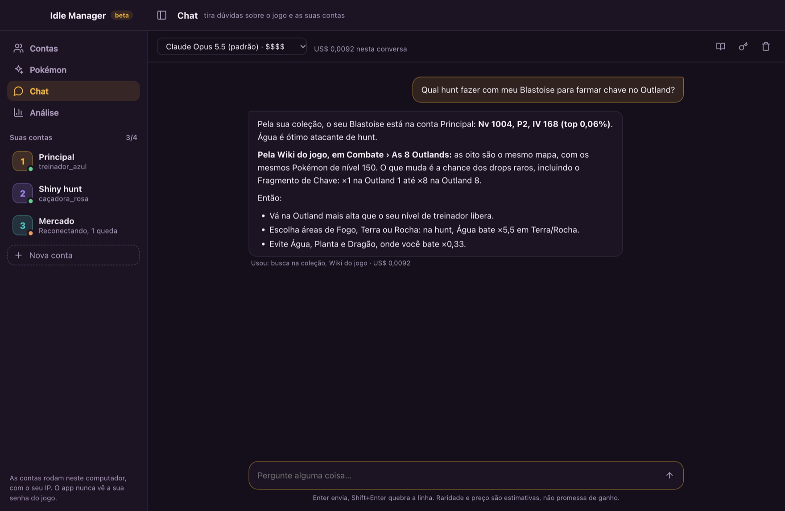
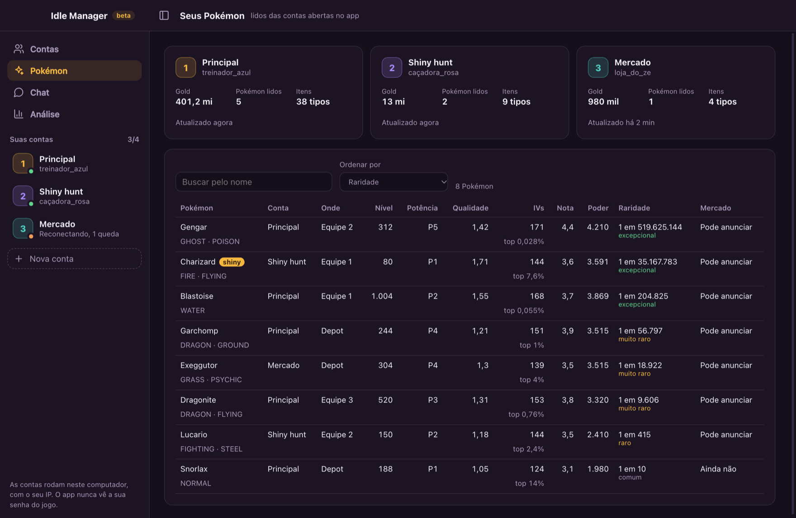
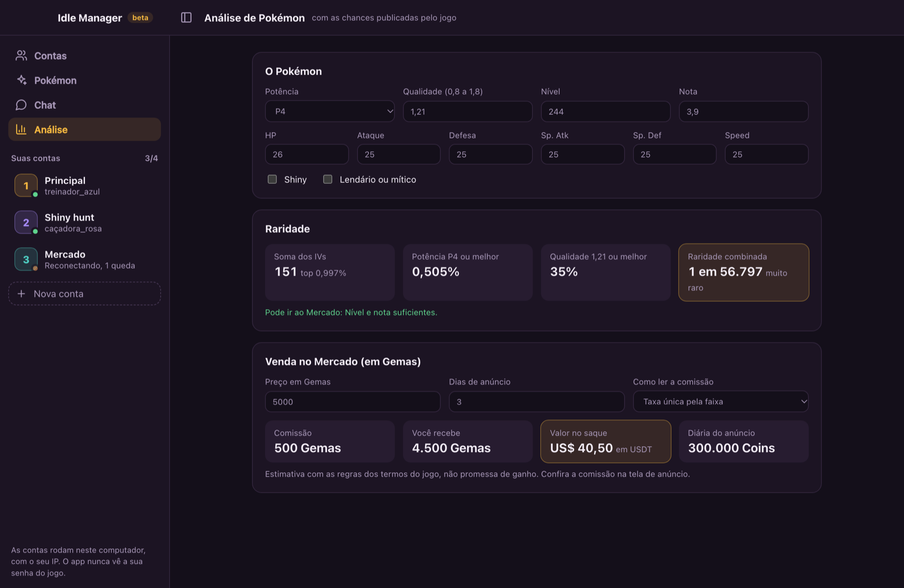

  

<h1 align="center">Idle Manager</h1>

  Suas contas do <a href="https://pokeidle.io/app">pokeidle.io</a> abertas lado a lado no seu Mac, com a
  raridade de cada Pokémon e um chat que conhece o jogo.

  
  
  

  <a href="https://github.com/Yespxx/idle-manager-app/releases/latest/download/Idle-Manager-mac.dmg"><b>Baixar para Mac</b></a>
  ·
  <a href="#instalar">Como instalar</a>
  ·
  <a href="https://github.com/Yespxx/idle-manager-app/issues">Avisar de um problema</a>

Imagens feitas com contas e Pokémon de exemplo.

## O que ele faz

- **Até 4 contas lado a lado.** Cada conta abre o jogo com login próprio e continua caçando com a janela
  minimizada. Se uma cair, o app recarrega sozinho e avisa. ⌘1 a ⌘4 trocam de conta.
- **Todos os seus Pokémon num lugar só.** IVs, potência, qualidade, nota, poder e a raridade de cada um,
  calculada pelas chances que o próprio jogo publica, de todas as contas numa tabela.
- **Um chat que conhece o jogo.** Pergunte em português qual hunt fazer, quais são os seus Pokémon mais
  raros ou quanto sobra de uma venda. A IA olha a sua coleção e a Wiki do jogo, com os números do servidor
  de hoje, em vez de chutar. Funciona com Claude, ChatGPT, Gemini e DeepSeek.
- **Análise e Mercado.** A raridade de qualquer Pokémon, se ele já pode ir ao Mercado e quanto você recebe
  de uma venda em Gemas e em USDT.

<table>
  <tr>
    <td width="50%"></td>
    <td width="50%"></td>
  </tr>
  <tr>
    <td align="center">Pokémon de todas as contas, do mais raro ao mais comum</td>
    <td align="center">Raridade e simulação de venda no Mercado</td>
  </tr>
</table>

## Instalar

Serve para Macs com chip Apple (M1 em diante). Ainda não tem versão para Windows nem para Mac com Intel.

1. Baixe o [**Idle-Manager-mac.dmg**](https://github.com/Yespxx/idle-manager-app/releases/latest/download/Idle-Manager-mac.dmg).
2. Dê dois cliques nele e arraste o **Idle Manager** para a pasta Aplicativos.
3. Na primeira vez, o Mac avisa que não conseguiu verificar o app, porque ele ainda não tem assinatura da
   Apple:
   - **macOS 14 ou anterior:** clique com o botão direito no app, escolha **Abrir** e depois **Abrir** de novo.
   - **macOS 15 ou mais novo:** tente abrir uma vez, vá em **Ajustes do Sistema › Privacidade e
     Segurança** e clique em **Abrir Mesmo Assim**.
4. Se o Mac pedir acesso ao "Idle Manager Safe Storage", clique em **Permitir Sempre**. É ali que ficam
   guardados, cifrados, os logins das contas.

Depois disso, ele abre normalmente pelo Launchpad ou pelo Spotlight (⌘ espaço e digite "Idle Manager").

### Atualizar

Baixe o `.dmg` de novo pelo mesmo link e arraste o app para Aplicativos, substituindo o antigo. As suas
contas, logins e dicas continuam onde estavam.

## Primeiros passos

1. Clique em **Nova conta**, dê um apelido e faça login na página do jogo que abre dentro do app. Prefira
   Discord ou e-mail: o Google pode bloquear login dentro de apps.
2. Para recarregar ou remover uma conta, clique nela com o botão direito. ⌘B recolhe a barra lateral e o
   jogo fica maior.
3. A aba **Pokémon** se enche sozinha conforme o jogo carrega cada conta.

### Ligar o chat

O chat usa uma chave sua da [OpenRouter](https://openrouter.ai), um serviço que dá acesso a várias IAs
com um cadastro só. Você paga só o que usar, centavos por pergunta.

1. Crie uma conta na OpenRouter, coloque créditos e crie uma chave em
   [openrouter.ai/keys](https://openrouter.ai/keys). Dica: coloque um limite de gasto na chave.
2. No app, abra a aba **Chat** e cole a chave. Ela fica cifrada no seu Mac.
3. Escolha o modelo no topo do chat. Cada um mostra a faixa de preço, de $ (bem barato) a $$$$, e o custo
   real aparece embaixo de cada resposta.

O ícone de livro no topo do chat abre **Editar minhas dicas**: escreva ali o que a comunidade sabe e a
Wiki não diz, e o chat passa a usar.

## Segurança e regras do jogo

- **O app nunca vê a sua senha.** O login é feito na página do próprio jogo, dentro do app.
- **Tudo fica no seu computador:** contas, leituras dos Pokémon, a Wiki e as suas dicas. As contas rodam
  com o seu IP, como no navegador.
- **Sem automação.** O app mantém as contas abertas, lê o que o jogo mostra e avisa quando uma cai. Ele não
  joga por você, não clica e não burla nenhuma regra.
- **Respeita o limite do jogo:** no máximo 4 contas por pessoa.
- As páginas do jogo rodam isoladas, sem acesso a câmera, microfone, localização ou arquivos do seu Mac.
- O chat só vê o que você pergunta e o que ele busca na sua coleção e na Wiki. O que vai para a IA segue
  a política da empresa do modelo que você escolher na OpenRouter.

## Perguntas frequentes

**Funciona no Windows?** Ainda não. Por enquanto só no Mac com chip Apple.

**Posso ser banido por usar?** O app não automatiza nada e respeita o limite de 4 contas, que é o que os
termos do pokeidle.io pedem. Ainda assim, quem decide é o jogo: leia os termos dele.

**O chat é de graça?** O app é. O chat cobra pela OpenRouter o que você usar, e você escolhe modelos
baratos se quiser.

**Achei um problema ou tenho uma ideia.** Abra uma [issue](https://github.com/Yespxx/idle-manager-app/issues)
contando o que aconteceu e, se der, com um print.

---

O Idle Manager é um projeto independente de jogadores, em beta. Ele não é do pokeidle.io nem da FASI
Sistemas e Tecnologias. Pokémon e os nomes dos Pokémon são marcas da Nintendo, Game Freak e Creatures.
